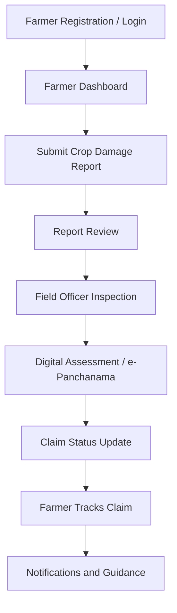
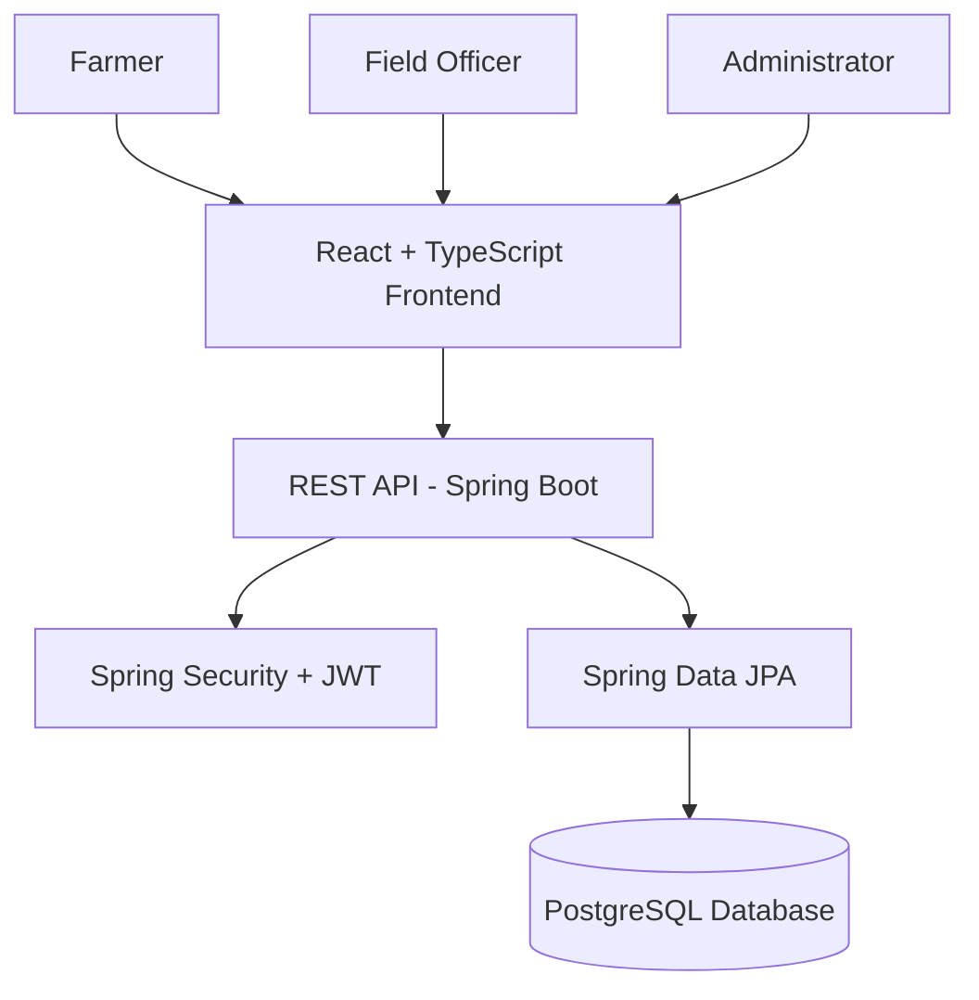

# 🌾 Crop Nexus
### Smart Digital Crop-Loss Reporting & Farmer Support Platform

**Empowering Farmers Through Digital Crop-Loss Assessment, Transparent Claim Tracking and Agricultural Support.**

[](https://github.com/rohitchaudhari045-eng/Crop-Nexus)
[](https://react.dev/)
[](https://spring.io/projects/spring-boot)
[](https://www.postgresql.org/)

---

## 📌 About the Project

**Crop Nexus** is a digital agriculture support platform designed to simplify crop-loss reporting, digital crop assessment, and compensation claim tracking for farmers.

Farmers often face difficulties when reporting crop damage caused by natural disasters such as heavy rainfall, floods, droughts, and other unexpected weather conditions. Traditional reporting and assessment processes can be time-consuming and difficult to follow.

Crop Nexus aims to bring farmers, field officers, and administrators together through one digital platform.

The platform provides dedicated dashboards and workflows to make crop-loss reporting more accessible, organized, and transparent.

## 🎯 Problem Statement

Farmers face several challenges during crop damage and compensation processes:

- Difficulties in reporting crop damage.
- Time-consuming manual documentation.
- Lack of transparency in claim status.
- Communication gaps between farmers and field officers.
- Difficulty accessing crop recovery guidance.
- Limited access to timely weather-related information.

## 💡 Our Solution

Crop Nexus provides a centralized digital platform that supports the crop-loss reporting and assessment process.

Through Crop Nexus:

- Farmers can submit crop damage reports.
- Field officers can review reports and conduct digital inspections.
- Farmers can track their claim progress.
- Administrators can manage users and monitor platform activities.
- Farmers can access crop recovery guidance and weather alerts.

## ✨ Key Features

### 👨‍🌾 1. Farmer Module
- Farmer registration and secure login.
- Dedicated farmer dashboard.
- Digital crop damage reporting.
- Crop-loss details submission.
- Claim status tracking.
- Crop recovery guidance.
- Weather alerts.
- Notifications and updates.

### 🧑‍💼 2. Field Officer Module
- Dedicated field officer dashboard.
- View submitted crop damage reports.
- Review farmer-submitted information.
- Digital inspection and e-Panchanama workflow support.
- Update inspection and assessment information.
- Manage assigned reports.

### 🛡️ 3. Admin Module
- Dedicated admin dashboard.
- Manage platform users.
- Monitor farmer reports and claims.
- Manage field officer activities.
- View platform information and updates.

## 🔄 How Crop Nexus Works



## 🏗️ System Architecture

Crop Nexus follows a frontend-backend architecture.



## 🛠️ Technology Stack

| Layer | Technologies |
|---|---|
| Frontend | React.js, TypeScript, Vite |
| Backend | Java 21, Spring Boot 4 |
| API | REST API |
| Security | Spring Security, JWT |
| Database | PostgreSQL |
| ORM | Spring Data JPA |
| API Documentation | Swagger UI |
| Version Control | Git, GitHub |

## ⚙️ Backend Highlights

The backend is designed using Java and Spring Boot.

- Java 21
- Spring Boot 4
- Spring Security with JWT authentication
- REST API base path: `/api/v1`
- 25 REST API endpoints
- PostgreSQL database integration
- Spring Data JPA
- 12 JPA entities
- Swagger UI API documentation

## 🗄️ Database

Crop Nexus uses PostgreSQL as its relational database.

Spring Data JPA is used for database operations and entity management.

The backend contains 12 JPA entities to organize application data.

## 🚀 Getting Started

### Prerequisites

Make sure the following tools are installed:

- Node.js and npm
- Java Development Kit (JDK 21)
- PostgreSQL
- Git

### 1. Clone the Repository

```bash
git clone https://github.com/rohitchaudhari045-eng/Crop-Nexus.git
```

### 2. Open the Project

Open the cloned project folder in your preferred code editor.

### 3. Run the Frontend

Open the frontend project directory containing `package.json`.

Install the dependencies:

```bash
npm install
```

Start the development server:

```bash
npm run dev
```

### 4. Run the Backend

Open the backend project directory containing the Maven `pom.xml` file.

Configure the PostgreSQL database connection using the backend's application configuration.

Run the Spring Boot application using your IDE or Maven.

**Note:** The exact database credentials and environment configuration depend on your local setup. Do not publish passwords, secret keys, or private credentials in this repository.

## 🔐 Security

Crop Nexus uses Spring Security and JWT-based authentication in its backend architecture.

Security-related implementation includes:

- Authentication support.
- Token-based authorization.
- Protected backend endpoints.
- Role-based access for different user modules.

## 🌱 Expected Impact

Crop Nexus aims to contribute to:

- Easier digital crop-loss reporting.
- Better organization of crop damage information.
- Improved communication between farmers and field officers.
- More transparent claim progress tracking.
- Easier access to agricultural guidance.
- Digital support for crop assessment workflows.

## 🔮 Future Scope

Potential future improvements include:

- Integration with official government agriculture services.
- Verified real-time weather API integration.
- AI-based crop damage analysis.
- Multilingual support for regional farmers.
- SMS and WhatsApp notifications.
- Mobile application for farmers.
- Advanced analytics and reporting.
- Expansion to support additional agricultural services.

*These are proposed improvements and are not claims of currently deployed integrations.*

## 👥 Team Conquerors

| Team Member | Role |
|---|---|
| **Rohit Manohar Chaudhari** | Team Leader & Frontend Developer |
| **Akshay Vinod Patil** | Backend Developer |

## 🏆 Innovation Challenge

**Project:** Crop Nexus  
**Team:** Team Conquerors  
**Event:** Seva First Innovation Challenge 2026  
**Focus Area:** Farmer Income Protection, Market Access and Digital Crop-Loss Assessment

## 📂 Project Repository

GitHub: [Crop Nexus Repository](https://github.com/rohitchaudhari045-eng/Crop-Nexus)

---

## ❤️ Our Vision

Our vision is to make agricultural support processes more accessible, transparent, and farmer-friendly through technology.

**Crop Nexus — Connecting Farmers, Technology and Agricultural Support.**

---

<p align="center">
  <b>🌾 Built with the vision of supporting farmers through digital innovation.</b>
  <br>
  <b>Team Conquerors | Crop Nexus</b>
</p>
